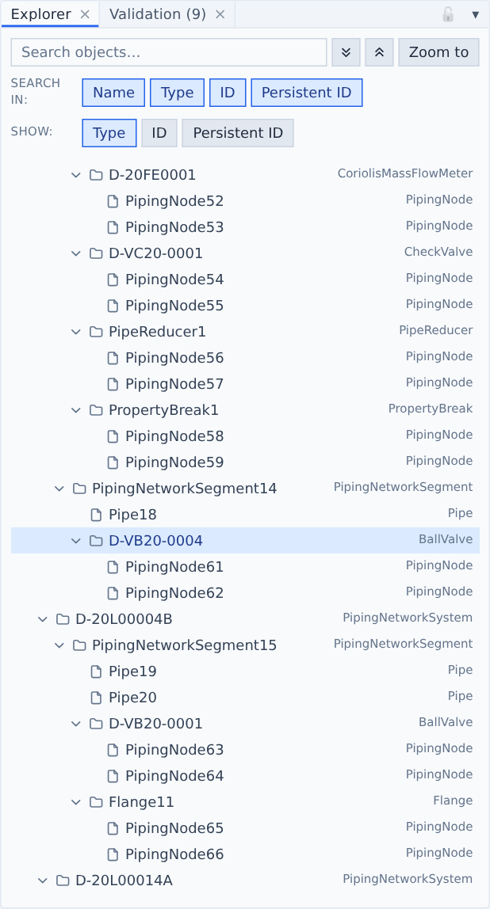
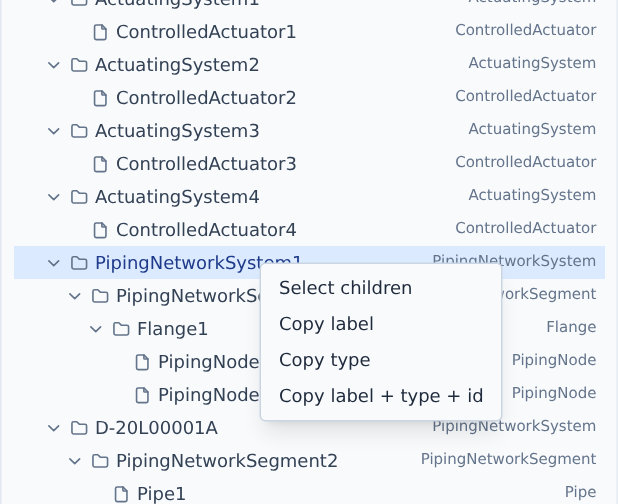
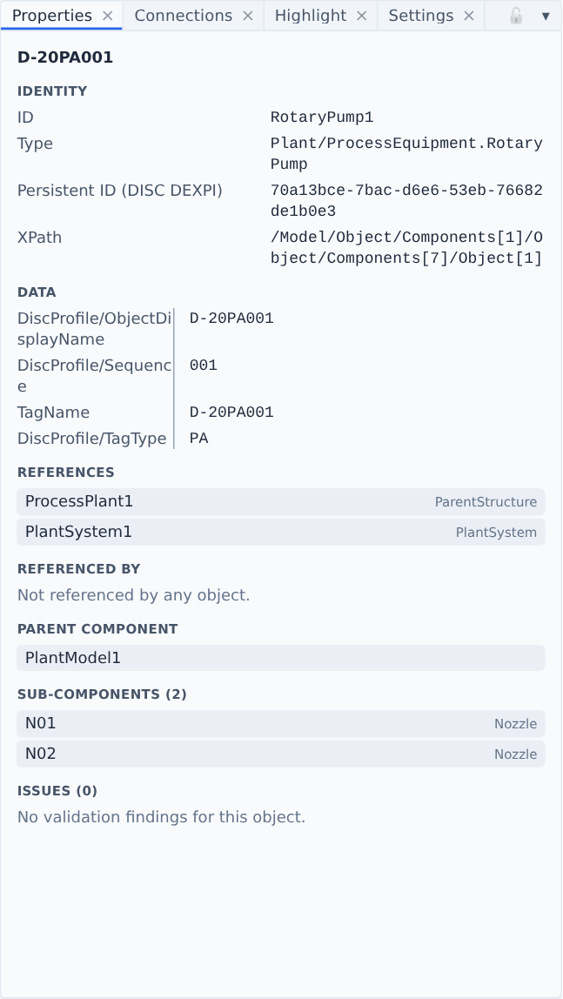

# Explorer & Properties

## Explorer

The plant hierarchy of the file — the ConceptualModel containment, one row per object.

1. **Search** — filters the tree as you type: a case-insensitive "contains" match. Matching rows keep their parents so you can see where they sit.
2. **Expand all / Collapse all.**
3. **Zoom to** — frames every selected object in the drawing. Selecting in the tree does not move the drawing by itself.
4. **Search in** — which fields the search looks at: Name, Type, ID, Persistent ID. At least one stays on.
5. **Show** — extra columns in the tree: Type (on by default), ID and Persistent ID.

Selecting works like a file manager: **click** selects, <kbd>Ctrl</kbd>/<kbd>Cmd</kbd>-**click** toggles a row, <kbd>Shift</kbd>-**click** selects a range. Hovering a row highlights the object on the drawing. When you select something elsewhere, the tree opens to it and scrolls it into view. Hover a row for a tooltip with its name, type, ID and persistent ID.

### Find an object

<!-- steps -->
1. Type part of a tag, name or type into **Search** (#1) — e.g. `PA001` or `BallValve`.
2. Narrow the fields in **Search in** (#4) if the match is too broad.
3. Click the row, then **Zoom to** (#3).

### Copy names and types

Right-click a row for its menu. If the row isn't selected yet, it is selected first.

1. **Select children** (rows with children only) selects the whole branch. **Copy label**, **Copy type** and **Copy label + type + id** put the selected objects on the clipboard, one per line; the last one is tab-separated and pastes straight into a spreadsheet.

## Properties

Everything about the selected object.

1. **Identity** — ID, type, persistent IDs and the object's XPath in the file.
2. **Data** — every attribute. Values the file leaves undefined show as a dimmed *(undefined)*; structured values are indented. Drag the line between the columns to resize them.
3. **References / Referenced by / Parent component / Sub-components** — related objects as chips. Click a chip to select that object, hover to highlight it.
4. **Issues** — this object's own validation findings, with your [severity overrides](validation.md#change-a-rules-severity) applied.

Objects that only exist on the drawing side (labels, shapes) have no conceptual data; Properties says so, and [Inspect](inspect.md) in Drawing mode shows them. Units are shown as conventional symbols (kW, °C) unless **Settings → Rendering → Spec unit names** is on.
