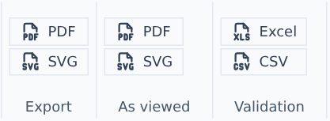

# Exports

1. **Export: PDF / SVG** — the drawing exactly as the file authors it, in its own colours (<kbd>E</kbd> then <kbd>P</kbd> / <kbd>S</kbd>).
2. **As viewed: PDF / SVG** — what is on your screen right now (<kbd>E</kbd> then <kbd>Shift</kbd>+<kbd>P</kbd> / <kbd>Shift</kbd>+<kbd>S</kbd>).
3. **Validation: Excel / CSV** — the findings as a report (<kbd>E</kbd> then <kbd>X</kbd> / <kbd>C</kbd>).

The buttons are enabled once a file is open. Files are named after the drawing: `<drawing>.pdf`, `<drawing>-as-viewed.svg`, `<drawing>-validation.xlsx` and so on.

## Drawing exports

- **PDF** — vector PDF with embedded metric-compatible fonts (Carlito / Liberation / DejaVu subsets).
- **SVG** — a standalone SVG of the drawing with full visual fidelity.

**As viewed** adds what you have switched on:

- Black & white mode.
- [Highlight](highlight.md) colours — hidden values stay hidden — and *Dim drawing*.
- Upstream / downstream traces.
- The underlay, at its current opacity, tint, hide-white and under/over placement.
- The [Label Inspect and Node Positions](highlight.md#label-inspect) overlays.

> [!NOTE]
> An *as viewed* export is always **light**: white paper and dark ink, whatever the app theme. The dark theme is a screen comfort setting, not part of the drawing — a dark export would print as pale ink on nothing.

The selection and hover marks are left out: they follow your pointer, they are not part of the drawing. An *as viewed* export that includes an underlay is part raster and noticeably larger; everything else stays vector.

### Make a marked-up PDF

<!-- steps -->
1. Set up the view: e.g. [Highlight](highlight.md) by fluid code, **B / W** on, and a downstream [trace](topology.md#trace-a-line).
2. Press **As viewed → PDF** (#2).
3. The PDF shows the drawing in ink with the tints and trace, on white paper.

## Validation reports

- **Excel** — an `.xlsx` workbook with a frozen bold header row, a filter on every column and `line` as a real number, so sorting and filtering work straight away. No delimiter or locale guessing, unlike CSV.
- **CSV** — the same findings as a CSV file.

Both apply your [severity overrides](validation.md#change-a-rules-severity) and carry the same columns:

| column | what it holds |
| --- | --- |
| `rule` | rule id, e.g. `SCH-002` |
| `category` | Schema, Graphics, Connectivity, Model or Meta data |
| `severity` | error, warning or info (after your overrides) |
| `objectId` | the object to select in the viewer, when the finding has one |
| `line` | source line of the offending element in your XML file |
| `xpath` | positional XPath of that element, e.g. `/Model/Object[1]/Components/Object/References[2]` |
| `message` | what is wrong |

`line` and `xpath` point at the element the finding is really about — for a dangling reference, the `<References>` element itself, not just the object that owns it — so you can jump straight to it in your XML editor. The Validation panel has the same two buttons in its toolbar.

Drawing labels always use conventional unit symbols (barg, °C, m³/h), whatever the unit setting.
