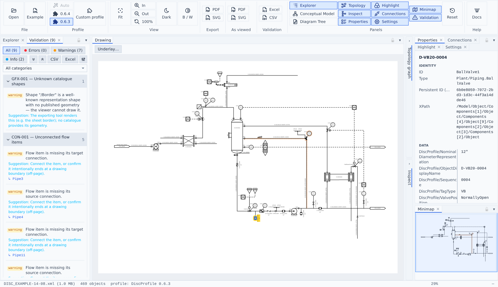
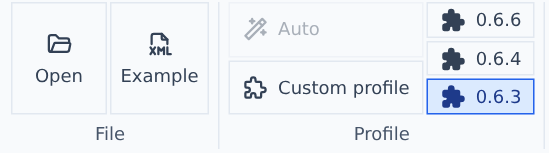
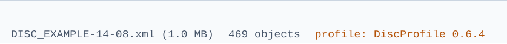
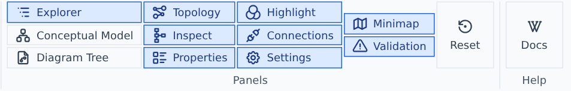

# Getting started

1. **Ribbon** — every command, grouped in sections. Each section is described below and on the panel pages.
2. **Explorer / Validation** — the plant hierarchy, and the findings of the automatic check. Validation comes to the front by itself when a file has findings.
3. **Drawing** — the P&ID itself. Click to select, drag to pan, wheel to zoom.
4. **Topology graph / Inspect** — two collapsed rails; click one to expand it.
5. **Properties / Connections / Highlight / Settings** — details of the selected object, flow tracing, colouring and app settings.
6. **Minimap** — the whole sheet with your current view outlined.
7. **Status bar** — file, object count, profile, zoom and cursor position.

## Open a file

1. **Open** — pick a DEXPI 2.0 `.xml` file (<kbd>Ctrl</kbd>+<kbd>O</kbd>). You can also drag a file anywhere onto the app.
2. **Example** — load a bundled official DISC example sheet (<kbd>Ctrl</kbd>+<kbd>Shift</kbd>+<kbd>O</kbd>).
3. **Auto / 0.6.4 / 0.6.3** — which DISC profile catalogue resolves the drawing's profile symbols. **Auto** follows the version the open document declares; a version button pins that bundled release.
4. **Custom profile** — load your own `DiscProfile.xml`.

<!-- steps -->
1. Press **Open** (#1) and choose a file, or drop it on the window.
2. Look at the status bar: if the profile field is **amber**, the loaded catalogue is not the one the document declares — pick the matching version (#3).
3. If symbols are missing from the drawing, no catalogue is loaded at all. Validation reports this too, with the version to load.

Only the DEXPI 2.0 XML serialization is supported (Proteus 4.x files from the DEXPI 1.x era are out of scope).

### Which profile version?

DiscProfile 0.6.4 is the first release to stamp its version, both in the catalogue itself and in the `<Import prefix="DiscProfile" …>` URI a drawing written against it carries. Turn on **Settings → Profile → Auto-load the declared profile** and opening a drawing loads the release it names; a drawing importing the older unversioned URI loads 0.6.3. Picking a version in the ribbon pins it — press **Auto** to hand the choice back to the document. **Auto** is greyed out while auto-loading is off.

The releases are not interchangeable: 0.6.4 adds eight symbols, removes two classes, relinks two symbols, and adds a `ShutoffCapability` field to 38 valve labels. A mismatch is reported in Validation as [META-003](rules.md).

## The status bar

1. **File** name and size (`No file loaded` before you open one).
2. **Object count.**
3. **Profile** — the loaded catalogue. Amber means it is not the release the document declares; hover it to see which one is.

At the right end: the zoom level, and the cursor position on the sheet in millimetres (`—` when the pointer is off the drawing).

## Arrange the panels

1. **Panel toggles** — show or hide each panel. A lit button means the panel is open. Two raw-XML browsers, **Conceptual Model** and **Diagram Tree**, are off by default (see [XML trees](xml-trees.md)).
2. **Reset** — back to the default layout (<kbd>Ctrl</kbd>+<kbd>Alt</kbd>+<kbd>R</kbd>).
3. **Docs** — opens this manual (<kbd>F1</kbd>).

The panel shell is the [tredespace UI](https://tredespace.com/docs/widgets) workbench, so every panel can be moved:

- **Drag** a panel by its tab to dock it anywhere — beside, above or below another, or onto it to form a **tab group**.
- **Float** a panel in its own window by dropping it away from the dock targets; dock it again the same way.
- **Collapse** a group to a slim rail with the chevron in its header, and click the rail to expand it again.
- **Resize** columns and rows by dragging the splitters between panels. Close a panel with the `×` on its tab.

The layout is remembered between sessions. If you get lost, **Reset** (#2) restores the default.

## Keyboard

Most commands have a single-key shortcut, so nothing collides with the browser: <kbd>F</kbd> fit, <kbd>B</kbd> black & white, <kbd>1</kbd>–<kbd>9</kbd> toggle panels, <kbd>E</kbd> then <kbd>P</kbd> export PDF. The full list, and how to change it, is in [Settings & shortcuts](settings.md#shortcuts).

## What is remembered

The app remembers the theme, the panel layout, rendering settings, profile auto-loading, rule severity overrides, Topology graph options, Node Positions appearance and your shortcuts. Everything else — the open file, highlight mode and custom filters, the underlay, traces, search text — is gone when you reload. Custom highlight filters can be saved to a file; see [Highlight](highlight.md#custom-filters).
