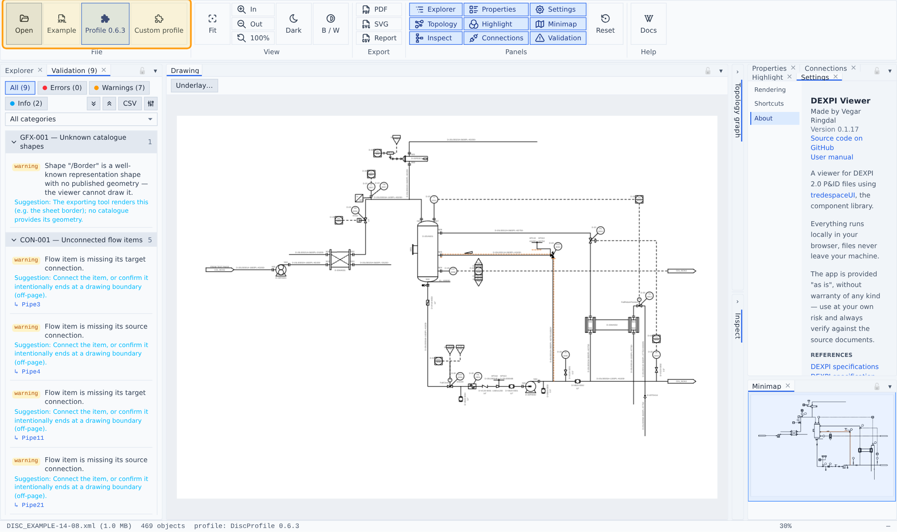
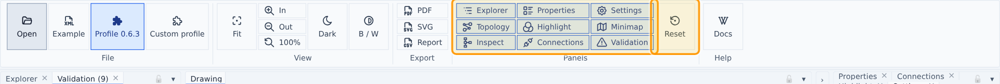
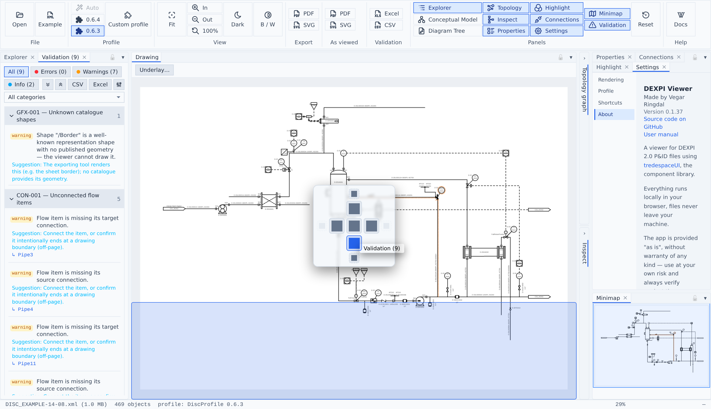

# Getting started

## Opening files

- **Open** (ribbon → File) or drag-and-drop a DEXPI 2.0 XML file anywhere onto the app.
- **Example** loads a bundled official DISC example sheet.
- **Profile** (ribbon) picks the DISC catalogue that resolves `Profile/SymbolUsage` references: **0.6.4** or **0.6.3** loads that bundled official release, **Custom profile** loads your own `DiscProfile.xml`, and **Auto** follows whatever the open document declares. The loaded profile survives document changes and is shown in the status bar.

### Which profile version?

DiscProfile 0.6.4 is the first release to stamp its version, both in the catalogue itself and in the `<Import prefix="DiscProfile" …>` URI a drawing written against it carries. Turn on **Settings → Profile → Auto-load the declared profile** and opening a drawing loads the release it names; a drawing importing the older unversioned URI loads 0.6.3. Picking a version in the ribbon pins it — press **Auto** to hand the choice back to the document.

The status bar turns amber when the loaded catalogue is not the release the document declares, and Validation reports the same thing as [META-003](rules.md). The releases are not interchangeable: 0.6.4 adds eight symbols, removes two classes, relinks two symbols, and adds a `ShutoffCapability` field to 38 valve labels.

Only the DEXPI 2.0 XML serialization is supported (Proteus 4.x files from the DEXPI 1.x era are out of scope).

## The workbench

Dockable panels around a central drawing: Explorer and Validation on the left, Properties / Connections / Highlight / Settings on the right with the Minimap below, and Topology graph + Inspect as collapsed rails next to the drawing (click their chevron to expand). Two more object browsers — [Conceptual Model Tree & Diagram Tree](xml-trees.md), raw-XML views alongside the Explorer — are off by default; toggle them on from ribbon → Panels.

The panel shell is the [tredespace UI](https://tredespace.com/docs/widgets) workbench, so every panel is fully rearrangeable:

- **Drag** a panel by its tab to dock it anywhere — side by side, stacked, or dropped onto another panel to form a **tab group**.
- **Float** a panel out of the dock into its own dialog window by dragging it free; re-dock it the same way.
- **Collapse** a panel group to a slim rail with the chevron in its header (Topology graph and Inspect start collapsed) and click the rail to expand it; the `▾` in a group header shrinks or restores the group in place.
- **Resize** any column or row by dragging the splitters between panels; close a panel with its tab's `×`.
- Toggle any panel on or off from ribbon → **Panels**.

The layout persists across sessions; if you get lost, ribbon → **Reset** restores the default layout.

## Shortcuts

Every ribbon action has a keyboard shortcut, rebindable in Settings → Shortcuts (click *Record*, press the new keys). Plain keys drive the app so nothing collides with the browser: **F** fit, **0** zoom 100%, **Z** then **I**/**O** zoom in/out, **D** theme, **B** black & white, digits **1–9** toggle the original panels, **T** then **C**/**D** toggles Conceptual Model Tree / Diagram Tree, **E** then **P**/**S**/**C**/**X** export PDF/SVG/CSV report/Excel report, **Ctrl+O** open a file, **F1** this manual. *Export keymap* saves your overrides as a portable JSON file; *Import keymap* applies one — unknown ids and conflicting keys are skipped, with a report of what happened.

## Status bar

File name and size, object count, loaded profile, zoom, and the cursor position in drawing millimetres.
