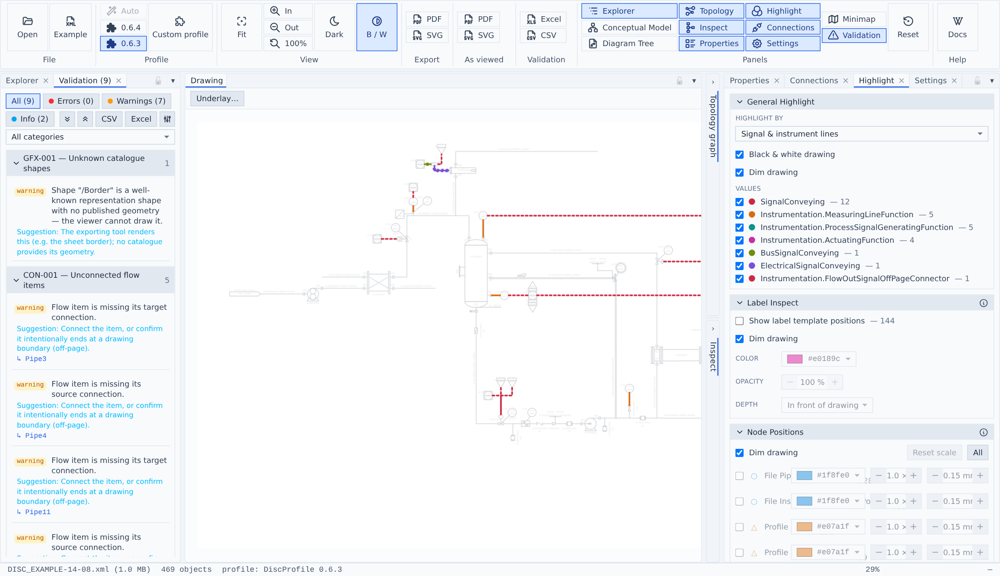
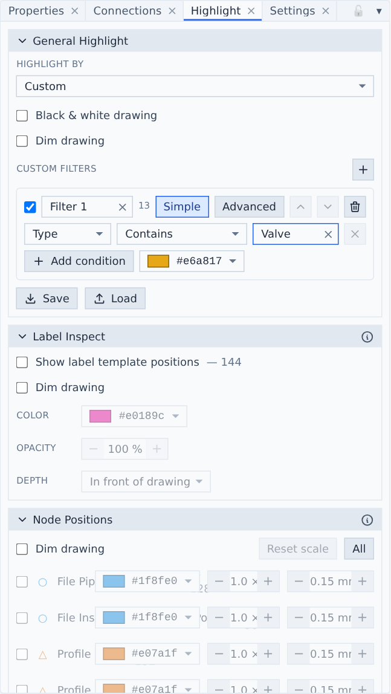
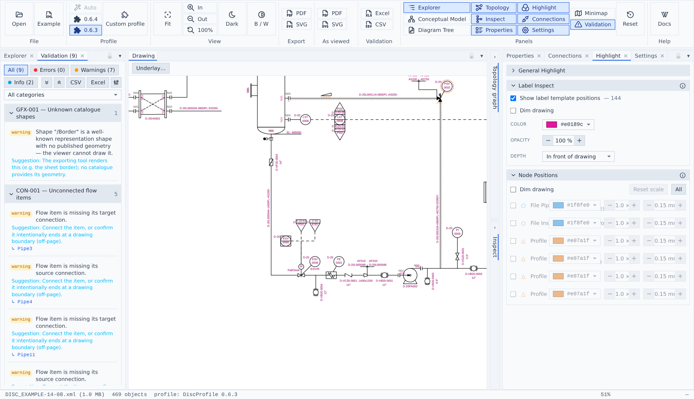
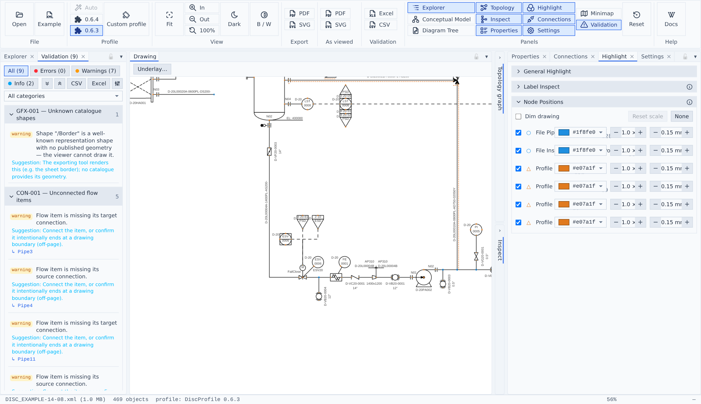

# Highlight

The Highlight panel colours the drawing. It has three sections whose overlays combine: **General Highlight** (classifications and custom filters), **Label Inspect** and **Node Positions**. Nothing here changes the file — it only changes what you see, and what an [*as viewed* export](export.md) contains.

## Colour by classification



1. **Highlight by** — Heat traced, Signal & instrument lines, Fluid code, Piping class, or Custom. Each choice shows how many objects it covers and is greyed out when the file has none. Fluid code and piping class are inherited from parent objects.
2. **Black & white drawing / Dim drawing** — draw the file in ink only so tints never mix with its own colours (the same switch as **B / W** in the ribbon), and lay a paper-coloured veil over the sheet so the tints stand out. *Dim drawing* only has an effect while some overlay is shown.
3. **Values** — one row per value, with its colour and count. Untick a value to hide its tint.
4. **B / W** in the ribbon is lit while black & white is on.

Signal mode groups lines **by signal type** (electrical, bus, measuring, …), so each type gets its own colour. The palette deliberately contains no blue — blue always means selection.

## Custom filters

For anything the built-in classifications don't cover, choose **Custom** in *Highlight by*.



1. **Add a filter.**
2. **Filter** — on/off checkbox, name, and the number of objects it matches.
3. **Simple / Advanced** — build conditions from drop-downs, or write an expression.
4. **Move up / Move down / Remove.**
5. **Condition** — field, operator and value. Fields: Type, Attribute (then name the attribute), ID, Persistent ID, XPath. Operators: *Contains*, *Does not contain*, *Equals (\* wildcard)*, *Does not equal (\* wildcard)*.
6. **Add condition** — conditions in one filter must all match (AND). The colour picker sets the filter's colour.
7. **Save / Load** — write the filter set to `dexpi-highlight-filters.json`, and read it back later or on another file.

Matching ignores case. An object without the field never matches — not even *Does not contain*. Empty values are ignored.

`*` is a wildcard for the *Equals* operators, so on XPath `/Model/Object[2]*` matches that object **and everything inside it**: an XPath runs from the root, so a child's path always starts with its parent's.

### Advanced expressions

Switch a filter to **Advanced** to combine terms with `&` (and), `|` (or) and parentheses. Switching over with an empty expression fills it in from your simple conditions.

```
TYPE = 'Piping.BallValve' & (ATTR('FluidCode') = 'A*' | ATTR('FluidCode') != 'B*')
```

Terms are `TYPE`, `ID`, `XPATH`, `PERSISTENT_ID` or `ATTR('name')`, followed by `=`, `!=` or `CONTAINS` and a quoted value. Mistakes are shown in red under the filter.

### When filters overlap

Filters apply top to bottom; where two match the same object, **the lower one wins**. A banner tells you how many objects are matched more than once, so an unintended overlap doesn't go unnoticed — reorder with the arrows (#4).

Custom filters are not remembered after a reload. Use **Save** (#7) to keep them.

## Label Inspect

Draws each DISC profile label template at the position, rotation, size and alignment the profile declares — so you can see where the profile expects a label to sit, and compare that with what the file actually places.



1. **Show label template positions** — the count is the number of templates on the sheet.
2. **Color / Opacity / Depth** — style of the markers, and whether they draw in front of or behind the drawing.

It needs a loaded DISC profile and a drawing that places profile symbols with label templates; otherwise the section says so.

## Node Positions

Marks the node positions the file declares (○) and those the profile declares (△), one row per kind.



1. **Reset scale / All** — put every marker back to 1× size; switch every kind on or off at once.
2. **One kind** — on/off, colour, marker size (0.2–10×) and outline width.

Colours and sizes are remembered between sessions; which kinds are on is not.
