# DEXPI Viewer manual

A fast viewer and checker for **DEXPI 2.0 XML** P&ID files. Everything runs in your browser — files never leave your machine.

> [!TIP]
> **How to read this manual.** Screenshots carry numbered markers; the list under each picture explains them, and the text points back with the same number, e.g. press **Open** (#1). Click any picture to see it full size.

## Start here

<a class="card" href="getting-started.md">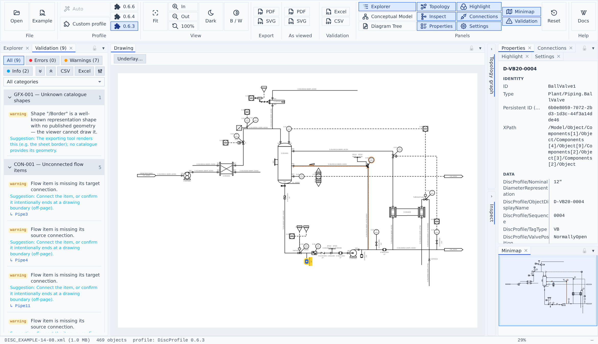<b>Getting started</b>Open a file, pick a profile, find your way around the workbench.</a>
<a class="card" href="tasks.md">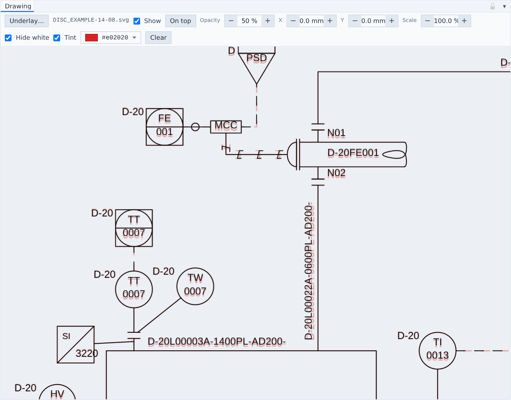<b>Common tasks</b>Step-by-step recipes: verify a drawing, trace a line, chase a finding.</a>

## Panels

<a class="card" href="viewing.md">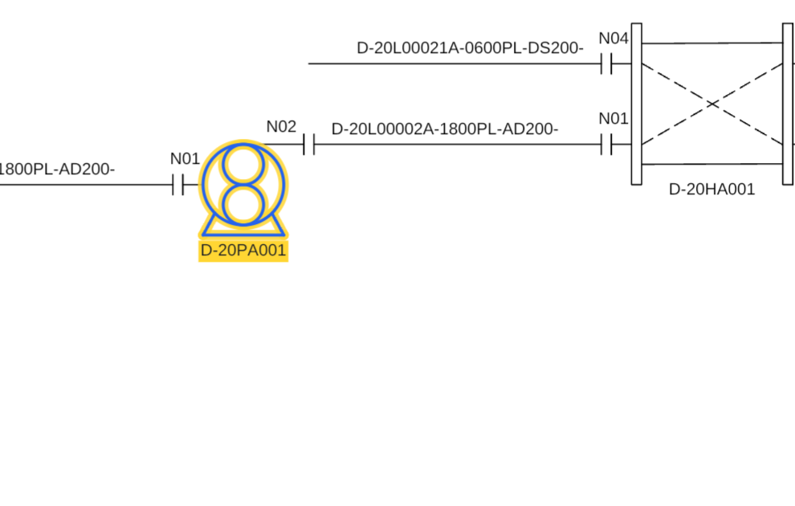<b>Viewing the drawing</b>Zoom, pan, select, the minimap and the verification underlay.</a>
<a class="card" href="explorer.md">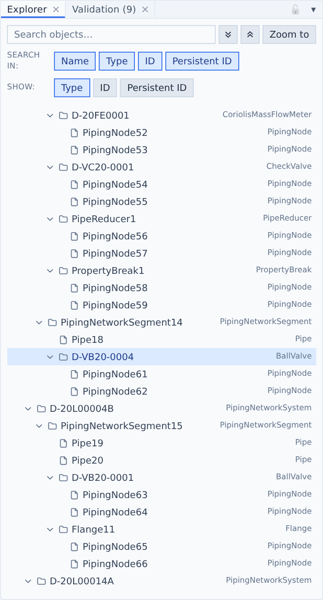<b>Explorer &amp; Properties</b>Search the plant hierarchy and read every value of an object.</a>
<a class="card" href="validation.md">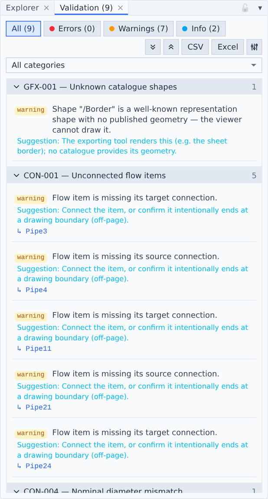<b>Validation</b>Findings, filters, severity overrides and reports.</a>
<a class="card" href="inspect.md">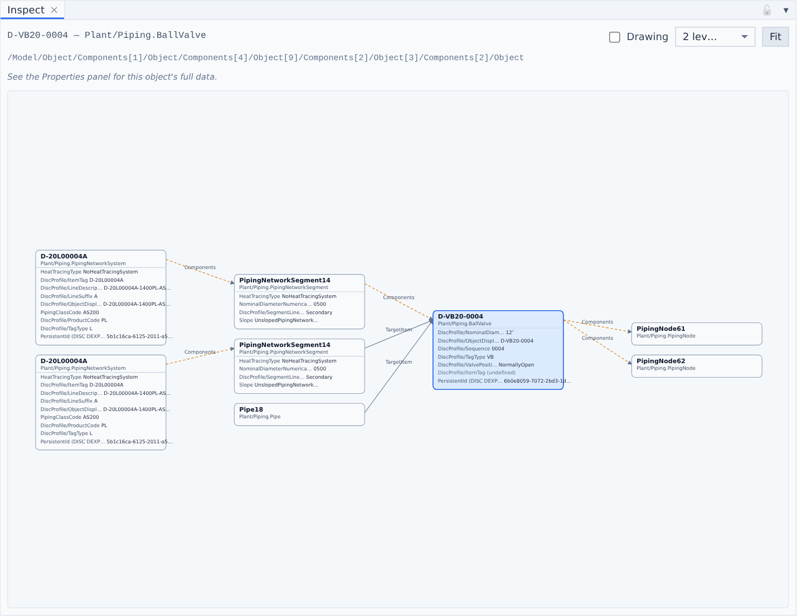<b>Inspect</b>A diagram of one object and everything it is connected to.</a>
<a class="card" href="xml-trees.md">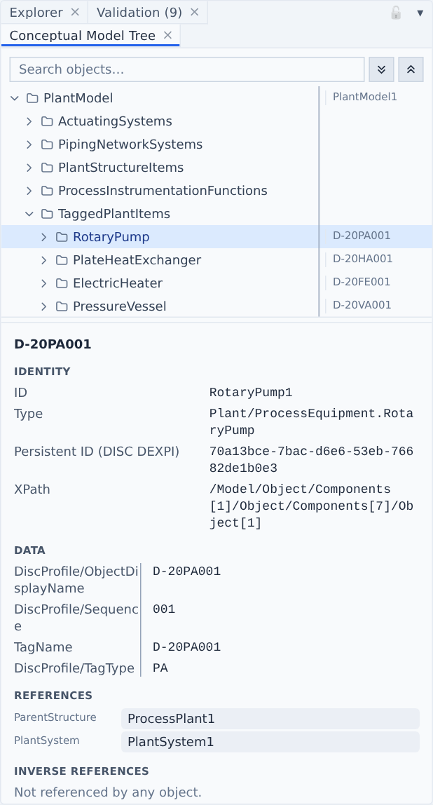<b>XML trees</b>The file's own structure: Conceptual Model Tree and Diagram Tree.</a>
<a class="card" href="topology.md">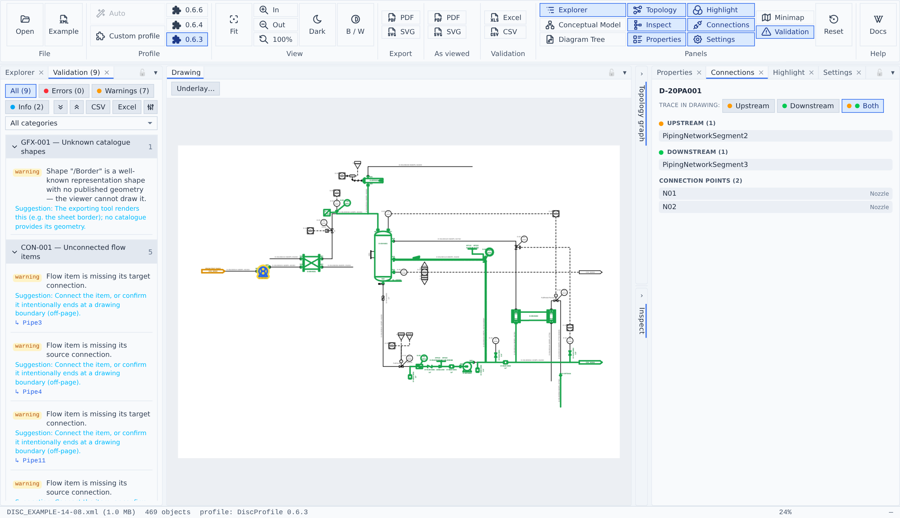<b>Topology &amp; connections</b>The semantic graph and upstream / downstream tracing.</a>
<a class="card" href="highlight.md">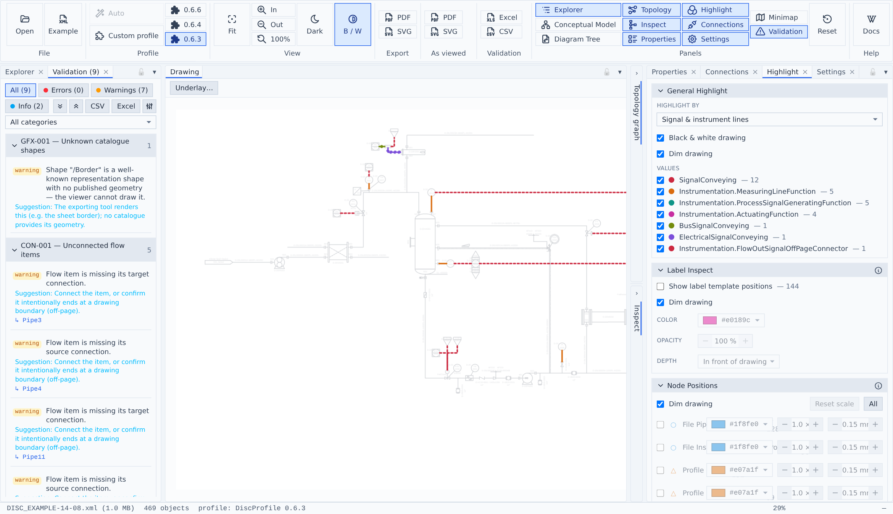<b>Highlight</b>Colour the drawing by classification or your own filters.</a>
<a class="card" href="export.md">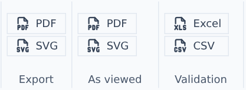<b>Exports</b>PDF, SVG and validation reports.</a>
<a class="card" href="settings.md">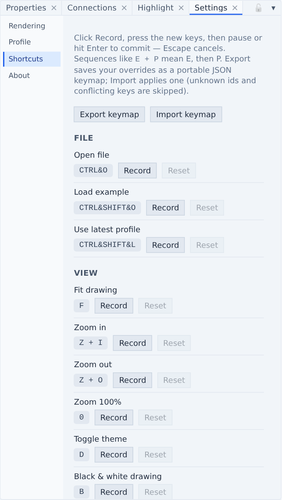<b>Settings &amp; shortcuts</b>Rendering options, profile loading and the keymap.</a>

## Reference

- [Conventions beyond the spec](conventions.md) — where no spec exists and what this viewer does instead
- [Validation rule reference](rules.md) — all rules with defaults and meaning *(generated)*
- [DEXPI 2.0 information model](metamodel.md) — the classes validation checks against *(generated)*
- [DiscProfile 0.6.6 symbol catalogue](symbols.md) — every profile symbol rendered *(generated)*

The screenshots in this manual use the official DISC example sheet `DISC_EXAMPLE-14-08` with DiscProfile 0.6.3.
