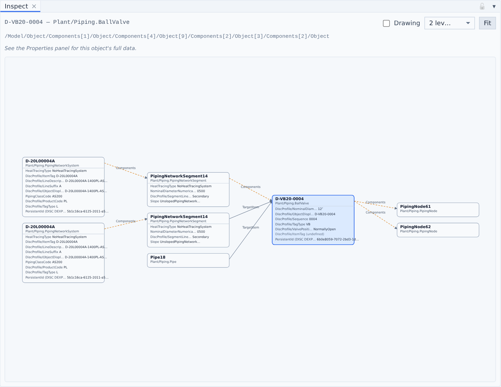
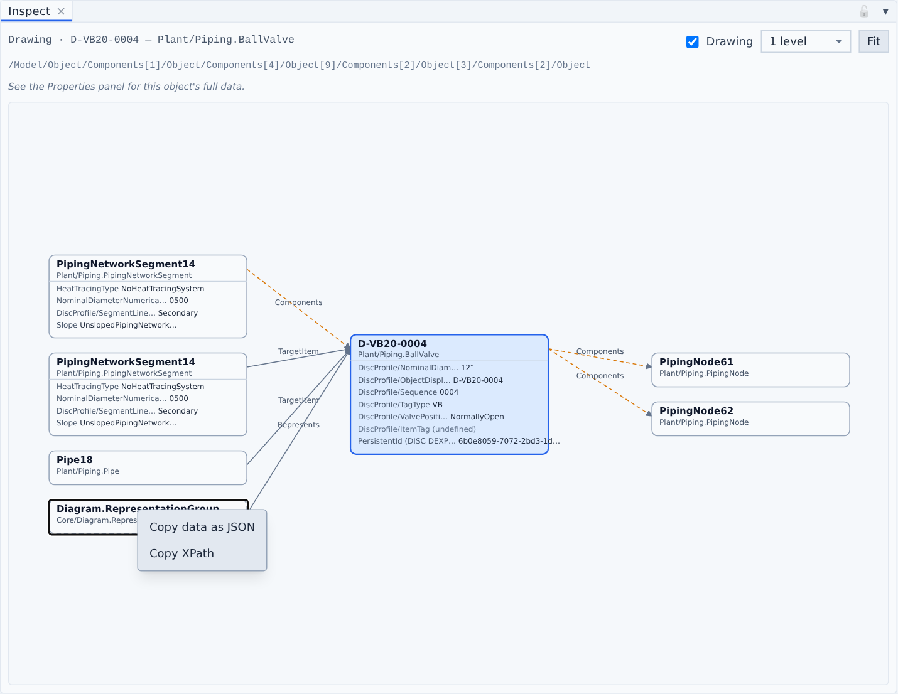

# Inspect panel

A diagram of the selected object and everything around it — the debug view for "how is this connected", without reading raw XML. Inspect starts as a collapsed rail next to the drawing; click it to expand.

1. **Drawing** — also show the drawing side of the file (see below).
2. **Depth** — how many levels of neighbours to show: 1, 2 or 3.
3. **Fit** — fit the whole diagram in the panel.

The header shows the object and its full XPath (it pastes straight into `xmllint --xpath`). Drag to pan and use the wheel to zoom inside the diagram.

## Reading the diagram

- The **centre card** (blue) is the selected object with its complete raw data — every property, including ones the file leaves `<Undefined/>` (dimmed, never hidden).
- **Neighbour cards** show every relation, with the edge labelled by the actual property name: outgoing references to the right; things that reference this object, and its containment parent, to the left; component children; and DISC profile instance stubs (violet) with the published instance's data.
- With a deeper **Depth** (#2), incoming relations chain further left and outgoing ones further right.
- **Click a card** to re-centre on it. The clicked card stays where it is on screen, so the view never jumps, and the selection everywhere else follows.
- **Problems show in red.** A finding about a specific property becomes a red row — a red `(missing)` row for a property that should be there, or the existing row turned red when its value is invalid. Hover the row for the full message. Cards keep a severity-coloured border; findings that don't belong to one property appear as compact ⚠ rows. A reference whose target does not exist draws as a red broken card with a red edge.

## Drawing mode

1. **Drawing** — adds the drawing side of the file to the diagram: representation groups, labels, shapes and lines. These cards have a **dashed border**. Drawing objects carry no ids in real files, so their positional XPath stands in as their identity. A plant object now shows its `Represents` group as an incoming neighbour.
2. **Right-click a card** — **Copy data as JSON** puts the object's complete raw data on the clipboard (every typed value, nested structures, multi-valued properties as arrays, references and components recursively). **Copy XPath** copies the element's positional path. The item confirms with *Copied ✓*.

Clicking a drawing card re-centres Inspect on it, makes the [Diagram Tree](xml-trees.md#diagram-tree) reveal that exact row, and moves the global selection to the plant object the card represents. The header reads `Drawing ·` while the mode is on, and a hint line says where the rest of the data lives — Properties for plant objects, Inspect itself for drawing-side ones.

Depth and the Drawing toggle reset when you reload.
