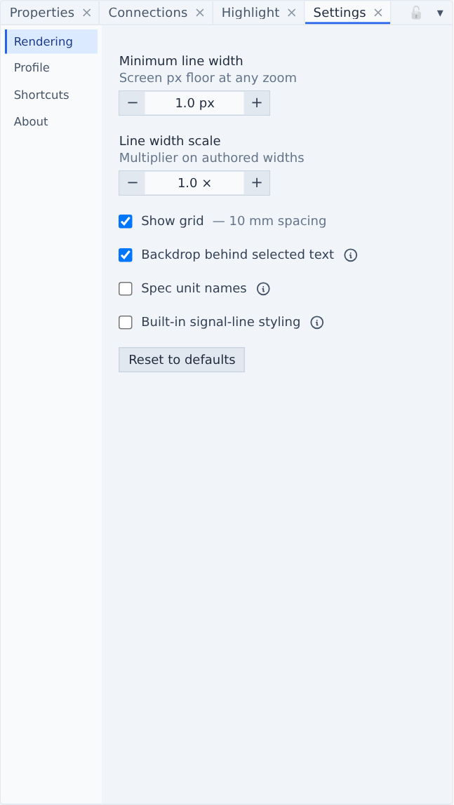
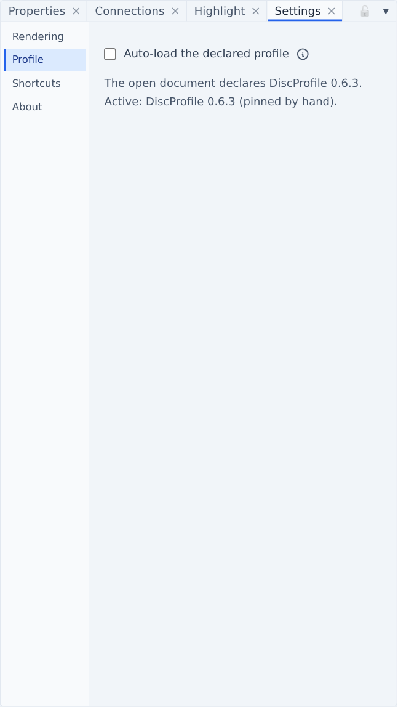
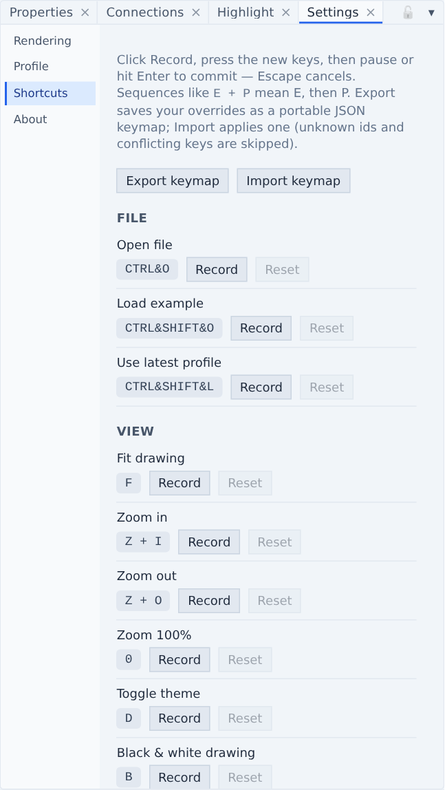

# Settings & shortcuts

The **Settings** panel (<kbd>9</kbd>) has four tabs: Rendering, Profile, Shortcuts and About. The app opens on About, with the version and links to the source code and this manual.

## Rendering

1. **Reset to defaults** — puts every rendering setting back.

| Setting | What it does | Default |
| --- | --- | --- |
| **Minimum line width** | Thinnest a line may get on screen, at any zoom (0.25–5 px) | 1 px |
| **Line width scale** | Multiplier on the widths the file authors (0.1–5×) | 1× |
| **Show grid** | 10 mm grid behind the sheet | on |
| **Backdrop behind selected text** | Yellow rectangle under selected text | on |
| **Spec unit names** | "Kilowatt" instead of "kW" in the Properties panel. Drawing labels always use symbols. | off |
| **Built-in signal-line styling** | Use the viewer's [signal-line convention](conventions.md#signal-line-styling) even when the profile publishes its own line styles | off |

The settings are remembered between sessions.

## Profile

1. **Auto-load the declared profile** — when a document opens, load the DISC profile release it declares. With this off, the ribbon's **Auto** button is greyed out and the catalogue only changes when you pick one.

Below it, the tab tells you which profile the open document declares and which catalogue is active — including whether you pinned it by hand. See [Which profile version?](getting-started.md#which-profile-version).

## Shortcuts

1. **Export keymap / Import keymap** — save your shortcuts as `dexpi-keymap.json`, or apply one. On import, unknown commands and keys that would clash are skipped, and a report says what happened.
2. **Record** — click it, press the new keys, then pause or press <kbd>Enter</kbd> to keep them. <kbd>Esc</kbd> cancels. If the keys are already taken, the row says by what.
3. **Reset** — this one shortcut back to its default. **Reset all to defaults** at the bottom resets them all.

### Default shortcuts

Shortcuts use plain keys so nothing collides with the browser. "<kbd>E</kbd> then <kbd>P</kbd>" means press E, release, then press P.

| Command | Keys |
| --- | --- |
| Open file | <kbd>Ctrl</kbd>+<kbd>O</kbd> |
| Load example | <kbd>Ctrl</kbd>+<kbd>Shift</kbd>+<kbd>O</kbd> |
| Use latest profile (0.6.6) | <kbd>Ctrl</kbd>+<kbd>Shift</kbd>+<kbd>L</kbd> |
| Fit drawing | <kbd>F</kbd> |
| Zoom in / out | <kbd>Z</kbd> then <kbd>I</kbd> / <kbd>O</kbd> |
| Zoom 100% | <kbd>0</kbd> |
| Toggle theme | <kbd>D</kbd> |
| Black & white drawing | <kbd>B</kbd> |
| Export PDF / SVG | <kbd>E</kbd> then <kbd>P</kbd> / <kbd>S</kbd> |
| Export PDF / SVG as viewed | <kbd>E</kbd> then <kbd>Shift</kbd>+<kbd>P</kbd> / <kbd>Shift</kbd>+<kbd>S</kbd> |
| Validation report Excel / CSV | <kbd>E</kbd> then <kbd>X</kbd> / <kbd>C</kbd> |
| Explorer, Properties, Validation, Connections, Highlight | <kbd>1</kbd>, <kbd>2</kbd>, <kbd>3</kbd>, <kbd>4</kbd>, <kbd>5</kbd> |
| Topology graph, Inspect, Minimap, Settings | <kbd>6</kbd>, <kbd>7</kbd>, <kbd>8</kbd>, <kbd>9</kbd> |
| Conceptual Model Tree / Diagram Tree | <kbd>T</kbd> then <kbd>C</kbd> / <kbd>D</kbd> |
| Reset layout | <kbd>Ctrl</kbd>+<kbd>Alt</kbd>+<kbd>R</kbd> |
| Open this manual | <kbd>F1</kbd> |

The panel keys toggle a panel on and off.

## About

Version, links, the licence (**Show license**, AGPL-3.0-only) and **Show third-party notices** for every bundled package.
