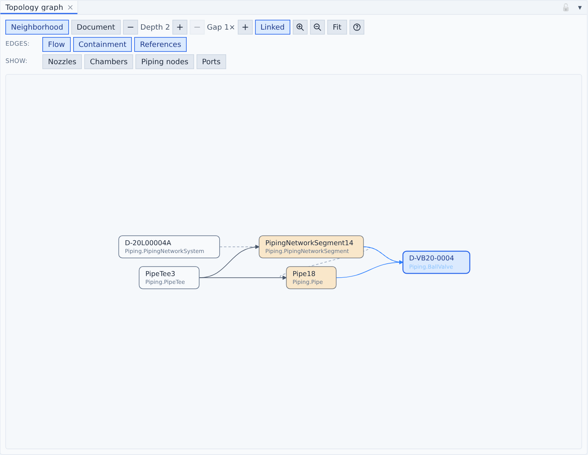
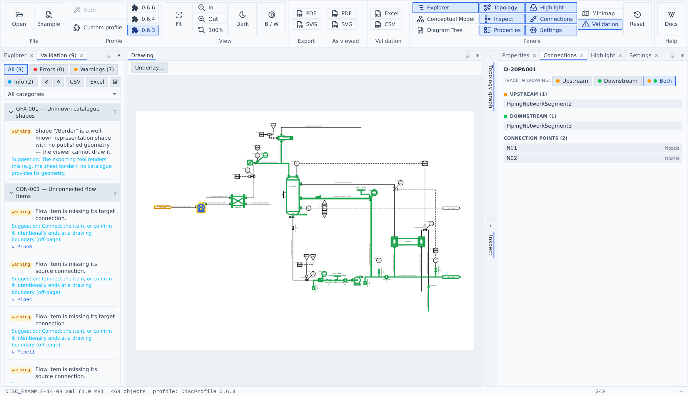

# Topology & connections

## Topology graph

The engineering data as a network: plant objects as nodes coloured by category, with **flow**, **containment** and **reference** edges, laid out along the flow direction. It starts as a collapsed rail next to the drawing; click it to expand.

1. **Neighborhood / Document** — graph the current selection and its surroundings, or the whole file. Document mode shows at most 400 objects; above that it tells you to use Neighborhood mode or the edge filters.
2. **Depth** — how many hops around the selection (1–6, Neighborhood mode only).
3. **Gap** — vertical spacing between nodes.
4. **Linked** — tint the selection's direct neighbours: amber upstream, green downstream, violet signal. Next to it: zoom in / out.
5. **Fit** — fit the graph in the panel. The **?** button next to it opens a legend explaining lines, borders, tints and mouse actions.
6. **Edges** — which relation kinds to draw: Flow, Containment, References. At least one stays on.
7. **Show** — connection hardware: Nozzles, Chambers, Piping nodes, Ports. Hidden hardware collapses into its owner.

With the mouse:

- **Click** a node to select it and re-centre the neighbourhood on it (the view stays put, so nothing jumps). <kbd>Ctrl</kbd>/<kbd>Cmd</kbd>-click adds to the selection without re-centring.
- **Double-click** a node to zoom the drawing to that object.
- **Hover** a node to highlight it on the drawing; its tooltip lists the type and up to eight attributes. Edge tooltips name the property.
- **Drag** to pan, **wheel** to zoom.

The graph's options are remembered between sessions.

## Connections & tracing

The **Connections** panel lists what flows into and out of the selected object, and traces the whole run through the piping.

1. **Trace in drawing** — **Upstream** (amber), **Downstream** (green) or **Both**. Click the active button again to clear the trace.
2. **Upstream** — what feeds this object.
3. **Downstream** — what this object feeds.
4. **Connection points** — its ports, nodes and nozzles.

Flow through an object's own nozzles counts as the object's own flow.

### Trace a line

<!-- steps -->
1. Select a pump, valve or pipe in the drawing.
2. Open **Connections** and press **Downstream** (#1). Everything the object feeds turns green in the drawing.
3. Click another object: the trace follows the selection and re-traces from there. It clears when you clear the selection or open another file.

If an object is part of a recirculation loop, the panel says so: those objects are both upstream and downstream, so both traces colour the same run.
