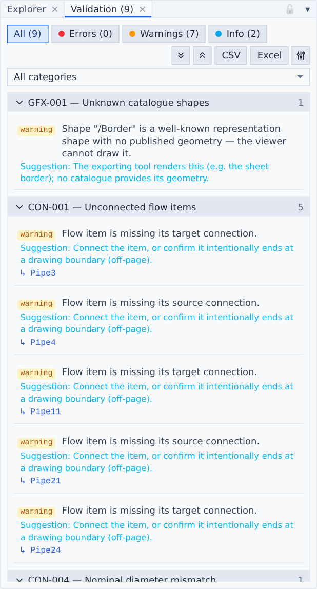
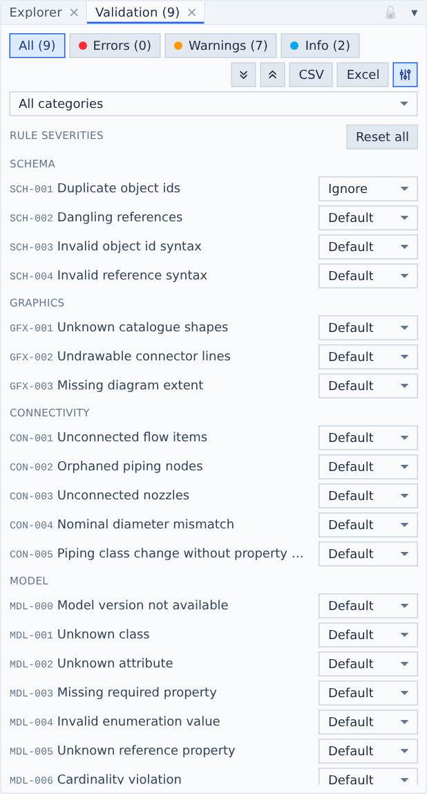

# Validation

Every file is checked as soon as it opens. The Validation tab shows the number of findings, e.g. **Validation (9)**, and comes to the front by itself when there are any.

1. **Severity filter** — All, Errors, Warnings or Info, each with its count.
2. **Expand all / Collapse all groups.**
3. **CSV / Excel** — save the findings as a report (see [Exports](export.md#validation-reports)).
4. **Rule severities** — change how serious each rule is, or switch it off.
5. **Category** — show one rule family only.
6. **Rule group** — one collapsible group per rule, with its id, title and count. Each finding has a severity chip, the message and often a blue *Suggestion* line.
7. **Object link** — click `↳ …` to select the object and zoom the drawing to it.

## Work through the findings

<!-- steps -->
1. Pick **Errors** (#1) to start with what is really broken.
2. Open a group (#6) and click a finding's object link (#7). The drawing zooms to the object, and Properties shows it with all its findings under **Issues**.
3. For the structure around the object, open [Inspect](inspect.md): findings tied to a property show as **red rows** on its cards.
4. Export the list with **Excel** (#3) when you need to hand it over. The report includes the source line and XPath of every finding, so the file's author can go straight to it.

## Rule families

Rules fall into five categories — see the full [rule reference](rules.md):

- **Schema (SCH)** — XML integrity: duplicate or dangling ids, identifier and reference syntax from the DEXPI XML Schema.
- **Graphics (GFX)** — drawing problems: unresolvable catalogue shapes, connector lines that cannot be drawn, missing extent.
- **Connectivity (CON)** — engineering topology: unconnected flow items, nodes and nozzles, nominal-diameter mismatches at connections, piping-class changes without a PropertyBreak.
- **Model (MDL)** — every object checked against the DEXPI information model: unknown classes or properties, missing required properties, illegal enumeration values, reference cardinality and target classes. The model version comes from the document's `data.dexpi.org` Import URIs; profile extension classes are honoured through their declared supertypes.
- **Meta data (META)** — template attribute references that resolve to nothing, and a loaded DISC catalogue that is not the release the document declares.

## Change a rule's severity

1. **Reset all** — remove every override.
2. **Per-rule setting** — *Default* keeps the built-in severity; *Error*, *Warning* and *Info* override it; *Ignore* hides the rule's findings everywhere.

Press the sliders button again to go back to the findings. Overrides are remembered between sessions and apply everywhere: the panel, the Issues section in Properties, Inspect, and both report formats.
