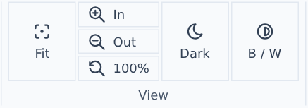
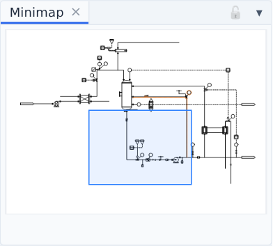
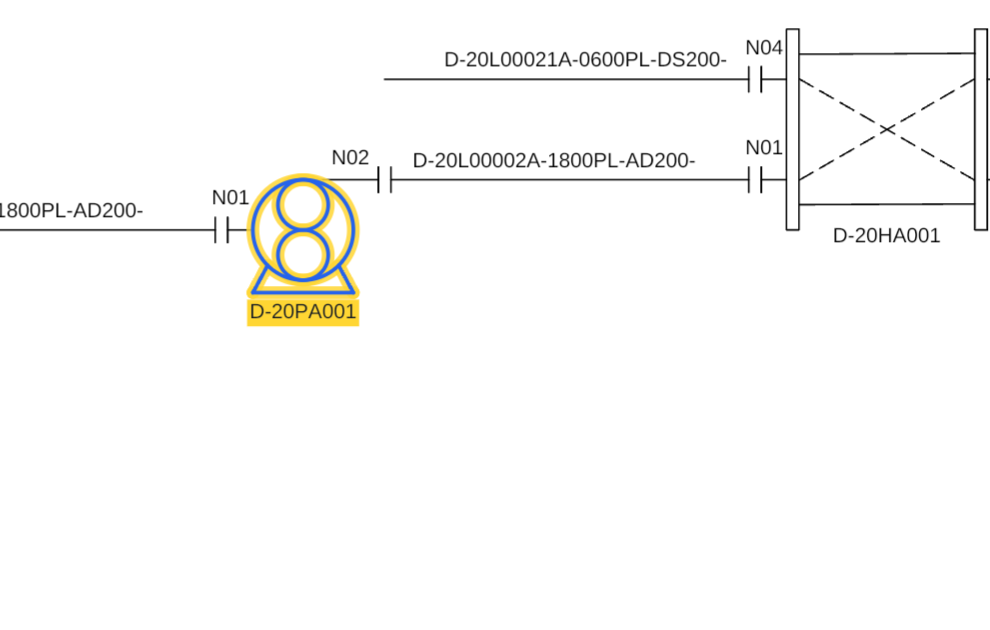
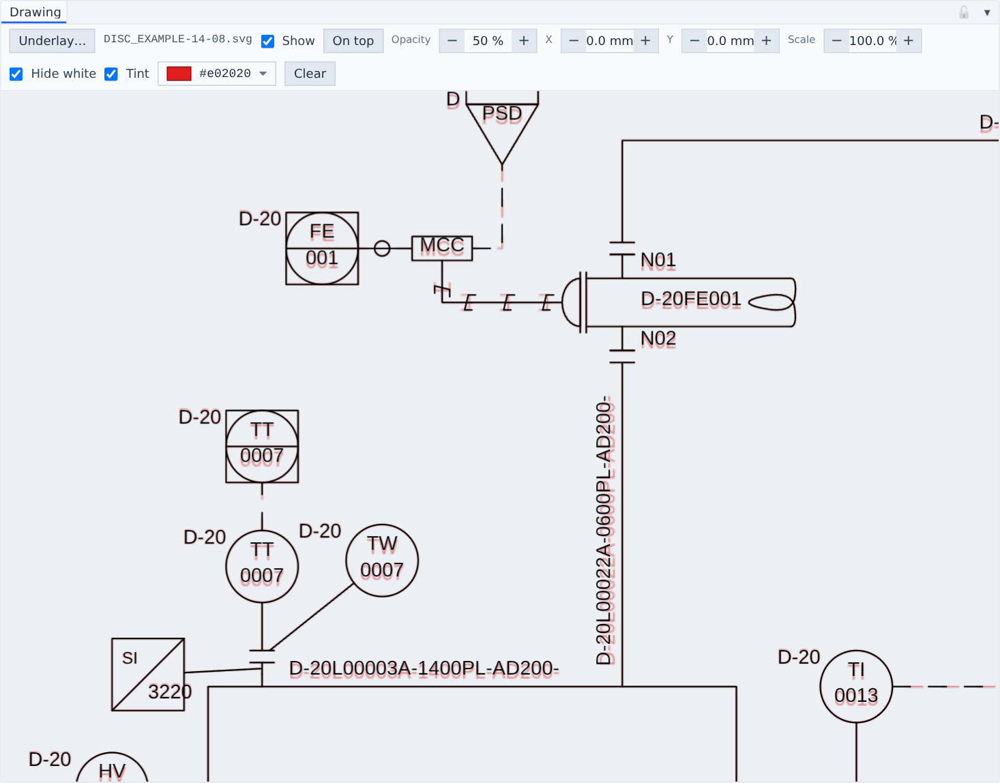

# Viewing the drawing

## Zoom and pan

1. **Fit** — the whole sheet in view (<kbd>F</kbd>).
2. **In / Out / 100%** — zoom by steps (<kbd>Z</kbd> then <kbd>I</kbd> / <kbd>O</kbd>) or to actual size (<kbd>0</kbd>).
3. **Dark / Light** — switch the app theme (<kbd>D</kbd>). The label shows the theme you will switch to.
4. **B / W** — draw the file in ink only, so [highlight](highlight.md) colours never mix with the drawing's own colours (<kbd>B</kbd>). The button stays lit while it is on.

With the mouse: the **wheel** zooms at the cursor, and **dragging** pans.

The **Minimap** shows the whole sheet with your current view as a blue rectangle. Click or drag in it to move the view there.

## Select objects

- **Click** an object to select it. Explorer, Properties, Connections, Inspect and the [XML trees](xml-trees.md) all follow.
- <kbd>Ctrl</kbd>/<kbd>Cmd</kbd>-**click** adds or removes objects from the selection.
- **Click empty paper** to clear the selection.
- **Hover** an object to highlight it; the status bar shows the cursor position in millimetres.

The selection is a **marker-pen yellow halo** that traces the object's own geometry under a blue re-stroke — not a bounding box, so a large exchanger does not flood its whole footprint. Selected **text** gets a yellow backdrop instead; turn it off under **Settings → Rendering → Backdrop behind selected text**. Dashed lines stay dashed when selected, so a heat-traced pipe keeps its trace distinguishable from the pipe itself.

To jump to an object from a panel, use **Zoom to** in the [Explorer](explorer.md), the `↳` object link in [Validation](validation.md), or double-click a node in the [Topology graph](topology.md).

## Compare against a reference rendering

The toolbar above the drawing loads a reference **image, SVG or PDF** as an underlay, stretched onto the drawing's extent. The official DISC renderings line up exactly, so any difference stands out.

1. **Underlay…** — choose the reference file (`.png .jpg .jpeg .webp .gif .bmp .svg .pdf`).
2. **Show / On top / Opacity** — show or hide it, draw it over instead of under the drawing, and set its opacity (default 50%).
3. **X / Y / Scale** — nudge it in 0.1 mm steps and scale it in percent, for scans that need aligning.
4. **Hide white / Tint** — *Hide white* drops the reference's white paper so only its ink shows; *Tint* recolours that ink (red by default) with the colour picker next to it.
5. **Clear** — remove the underlay.

<!-- steps -->
1. Open the DEXPI file, then press **Underlay…** (#1) and choose the official rendering of the same sheet.
2. Tick **Hide white** and **Tint** (#4). Red reference ink now sits under the black drawing.
3. Zoom in. Where the two agree you see black on red; anything only red is missing from the drawing, anything only black is extra.

When the underlay sits *under* the drawing, the sheet's own white paper is suppressed automatically so the reference shows through. Underlay settings are not remembered after a reload.

## Rendering settings

Line widths, the grid, unit names and signal-line styling are under [Settings → Rendering](settings.md#rendering).
