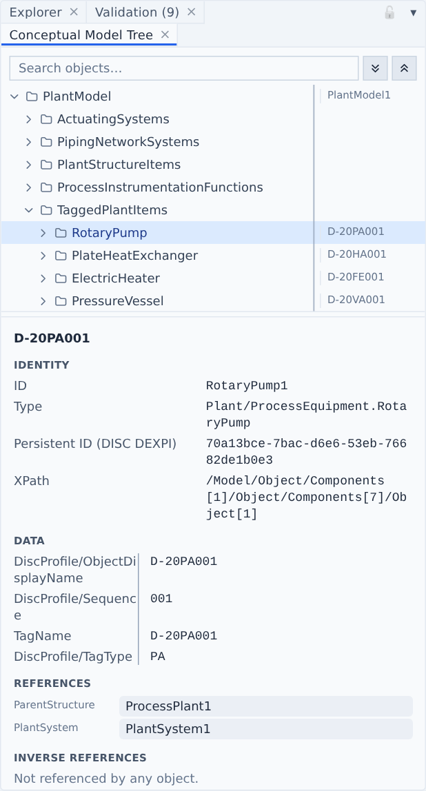
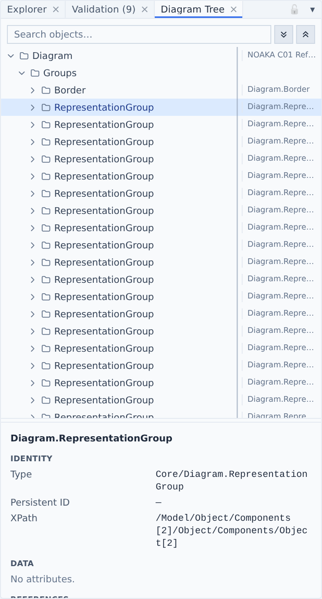

# Conceptual Model Tree & Diagram Tree

Two raw-XML browsers for when you need to see the file exactly as it is structured, not the Explorer's flattened plant hierarchy. Both are off by default: turn them on with **Conceptual Model** and **Diagram Tree** in ribbon → Panels (<kbd>T</kbd> then <kbd>C</kbd> / <kbd>D</kbd>). They open as tabs next to the Explorer.

Each tree mirrors one composition of the file: one expandable group row per `<Components property=…>` bucket (e.g. `ActuatingSystems`, `TaggedPlantItems`) and one row per object under it, nested as deep as the file nests. The **Conceptual Model Tree** covers `ConceptualModel`; the **Diagram Tree** covers the `Diagram` composition (representation groups, labels, shapes). Rows show the **type** in the main column and the resolved tag or value (TagName, ItemTag, SegmentNumber, …) in the second.

## Conceptual Model Tree

1. **Search** — filters by name, type, ID and persistent ID. Next to it: **Expand all / Collapse all**.
2. **Column divider** — drag to resize the type column.
3. **Section divider** — drag to give the tree or the data below it more room.
4. **Data** — the selected row's identity, attributes (structured values like `Stroke` or `Color` render as an indented block) and **References**. Reference targets are chips: an object in the file, a DISC profile instance or symbol (expand it for its data), or a red **unresolved** chip when the target does not exist.
5. **Inverse References** — every object that references this one, grouped as `Type.property` (e.g. `AttributeRepresentation.Object [2]`).

Selection is shared with the rest of the app, including <kbd>Ctrl</kbd>/<kbd>Shift</kbd> multi-select and the same right-click menu as the [Explorer](explorer.md#copy-names-and-types). Both trees start collapsed and open up to whatever is selected elsewhere.

## Diagram Tree

Same layout, for the drawing side. Drawing objects carry no `id` in real files, so rows use their positional XPath as identity. Selection here is local and single: clicking a row

- centres [Inspect](inspect.md) on exactly that row (switching Inspect to Drawing mode), and
- selects the plant object the row draws or annotates, through its `Represents` / `Object` reference, so the drawing, Properties and Explorer follow.

Selecting a plant object elsewhere reveals the row that represents it. Right-click selects a row; there is no menu.
